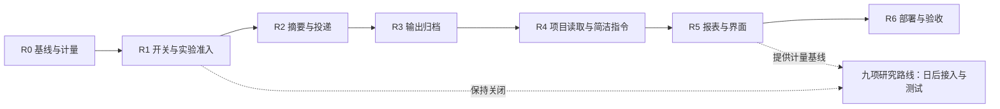

# 成员摘要与上下文优化路线图

2026-10-22 · 执行规格，以本文件为本轮实施依据。`成员自述摘要增量方案-old.md` 保留为历史提案；同目录其他摘要方案是参考资料，不表示其依赖已安装或实验已验收。

## 目标与边界

保存完整原文，用作者自述摘要帮助发现历史；只在首次省略全文、交接或新分支重建时计算摘要替代量。已投递原文不从原会话历史中改写或删除，追加摘要不计为历史缩短。

投递选择按接收者、分支、轮次记录。`full` 是原文；`menu` 是摘要与可回取指针；`dual` 是全文与摘要，仅保留为实验项。记录描述投递与回取，不宣称模型实际阅读、理解或采用了某段内容。

正式方案、用户约束、相关未决异议、失败尝试及批准/执行证据保留原文来源。评审与表态不因摘要设置而省略当前方案及已记录争议。共识与授权继续使用原表态、版本哈希与真实批准。执行者不获得群聊读取权限。

关闭优化后未来调用回到原组包策略；已生成历史仍保留。已有归档仍提供回取工具，同一执行身份可跨执行分支读取自己的输出，不能跨角色读取讨论输出。逐字节回归只用于固定输入和固定状态的确定性组包，不承诺真实模型重跑逐字节一致。

## 板块、依赖与验收

| 板块 | 范围 | 部署/默认 | 验收证据 |
| --- | --- | --- | --- |
| R0 基线与计量 | 输入总量包含缓存；缓存读写是输入子项；输出包含推理子项；缺失保持未知；API 前缀变化记录 | 计量常开、只读 | 基线 201 项通过，后续见本轮报告 |
| R1 房间开关与实验登记 | 总开关、摘要四场合开关、简洁输出、输出预览、只读项目工具；实验独立登记 | 默认关闭优化，监测常开；现有房间配置保持 | 类型/范围校验、关闭回归、缺依赖不可假启用 |
| R2 作者摘要与投递 | 同一回复生成、严格解析、无摘要不补问；分页目录、准确覆盖、分段回取；交接补看 | 房间选择开启 | 原文哈希不变、失败不提交覆盖、目录预算、不可用摘要回退 |
| R3 输出归档与回取 | 宿主验收、只读 Git、执行器工具结果在预览前归档；预览明确省略；权限与分页 | 房间选择开启；不把预览称为语义压缩 | 末尾错误可完整回取、长行预算、跨房间/执行者权限拒绝 |
| R4 项目资料与简洁输出 | 各适配器统一只读文件读取/搜索；稳定的短发言指令，代码/契约不截断 | 独立开关；现有快照作为回退 | 路径与凭据目录限制、真实工具循环、角色隔离 |
| R5 报表与界面 | 按成员/角色/会话/日期/阶段汇总；已知/未知；全文/摘要/编号/回取记录；实验状态 | 只读报表常开 | 缓存不重复相加、分页回取不误报全文、设置持久化 |
| R6 集成部署 | 隔离回归、浏览器功能检查、本机服务切换与版本核对 | 空闲时重启后端；不取消运行任务 | 测试 JSON、部署检查、健康与界面记录 |

## 日后测试的路线（不作为本轮已实现能力）

每项独立开关，默认关闭；保留 `待测试/未安装/不可用` 原因。尚未具备实现或合格测试证据时，启用请求应明确拒绝，不能只把布尔值保存为“已启用”。关闭总开关停止未来优化。模型请求与工具结果只允许一层主动改写，记录来源及版本。

| 实验项 | 要验证的内容 | 开启前提与失败退路 |
| --- | --- | --- |
| dual 双投递 | 对误读、返工、输入费用的实际影响，不能预先假定改善 | 多次配对端到端实验；预算不足回退 full 或 menu，关键材料不降档 |
| Headroom | Windows、现有适配器、关键事实保留、回取 TTL、净费用与延迟 | 固定上游版本与许可；宿主原文存储独立于上游 TTL；失败使用归档预览 |
| Aider RepoMap | 当前工作树/未跟踪文件一致性、任务相关覆盖、硬预算、读取工具可达 | 固定版本；不以 HEAD 哈希代替工作树版本；失败使用原项目快照 |
| TOON | 官方序列化器、字段往返、实际 tokenizer 长度、引用正确率 | 固定版本；仅更短且无损时采用；失败为紧凑 JSON |
| ccusage | 同身份/同会话/同时间窗对账；不覆盖自定义 API 归因 | A1 保持主数据源；不把本地五小时分桶当作服务商真实额度窗口 |
| CoMem | 真实权重、量化与 KV 内存、中文讨论、关键事实、决策质量及异步新鲜度 | 研究项；一致性不能替代成功率；不可用退回作者摘要/原文 |
| Context Mode | 现有契约权限、工具路由、误拦、跨平台和延迟 | 单独审计能力边界；不因 token 优化扩大执行权限 |
| Claude-Mem | 角色与房间隔离、版本失效、跨会话污染、注入成本 | 失败停止外部记忆注入，保留宿主账本 |
| LLMLingua | 代码、路径、否定句、版本号与结构化证据的保留 | 仅工具输出实验；禁止默认压缩契约、批准与关键争议 |

摘要缺失时本轮不追问、不生成第三方替代摘要。若日后恢复摘要补问，必须另行测量重带会话历史的输入成本、等待时间与覆盖变化；当前没有发起补问的运行路径。输出长度的硬截断同样不属于本轮实现，简洁指令不会截断已生成的正文或契约。

## 计量与实验方法

`input` 为输入总量，`cached_read/cache_write` 是子项，`output` 包含 `reasoning` 子项；不能把这些字段直接相加为总 token。未缓存输入仅在足够数据已知时派生。订阅制显示 token 与估算信息，不伪造实际 API 账单。

组包分项估算与观察计数分开存储；`feed_full/menu/dual` 计数不得再次加入 token 合计。省略原文估算只作潜在替代量，不作为已实现净节省。真实净费用、任务成功率与总延迟必须通过配对基线测量。

离线验收固定输入和状态，覆盖摘要失真、否定句、旧异议、长日志、超长单行、失败调用、部分回取和关闭回归。端到端效果日后使用固定任务集多次配对运行；记录服务商、型号、适配器、缓存条件、失败和回取。没有足够样本时显示“未验证”，不自动宣称收益、不凭两周自然流量直接归因关停。

实验监测不得单独关闭；关闭功能即可停止实验。基础计数不存完整 payload。将来如需样本留存，单独实现脱敏、限量、14 天清理与用户清空；本轮不默认留存模型请求样本。

## 本轮进度

- [x] R0 基线回归：201 项，0 失败、0 错误、2 跳过。
- [x] R0/R1 计量与开关：包容式用量口径、前缀观察、房间独立设置、实验准入。
- [x] R2 摘要与投递：严格作者解析、有界目录、成功后提交、分段覆盖、交接与关键原文保护。
- [x] R3 输出归档：宿主验收、实际 Bash 子进程及 Git 工具通过完整回取验证。
- [x] R4 项目读取与输出简洁：API 和真实 MCP 清单验证；执行者不获群聊工具。
- [x] R5 报表与界面：六种分组、伦敦日期、真实接口与明暗主题检查。
- [x] R6 部署与集成验收：230 项回归，228 通过、0 失败、2 条件跳过；本机 0.13.0 健康检查通过，部署前数据库已备份。

验收分层：上述勾选表示功能与工程验收完成；真实模型的摘要忠实度、完整任务净费用和返工率仍待日后配对实测。九项外部/研究路线仍未开放，不因基础板块完成而宣称已接入。

实际验收状态、限制与部署版本以 `test-reports/summary-roadmap-2026-10-22/README.md` 为准。实验项通过准入前继续显示待测试。
